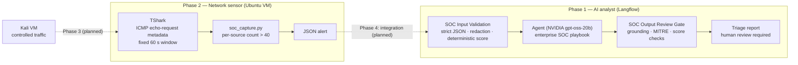

# SOC AI Analyst Home Lab

An AI-assisted Security Operations Center (SOC) triage lab: a **Python/TShark network sensor** produces structured JSON alerts, and a **Langflow + NVIDIA-hosted LLM analyst** turns those alerts into validated, human-reviewable triage reports with risk scores, MITRE ATT&CK mapping and investigation recommendations.

The focus is on making the AI **trustworthy**: deterministic scoring done in code (not by the model), strict input validation, credential redaction, an output review gate that rejects hallucinated or unsupported claims, and mandatory human review.

> **Status:** Phases 1–2 complete ✅ · Phase 3 (controlled Kali traffic) next
>
> **Related project:** [Wazuh SOC Lab](https://github.com/k-Darshan-chowdary/Wazuh-SOC-LAB) — the SIEM and detection-engineering side of the same home lab (Wazuh, Sysmon, custom rules, MITRE mapping).

---

## Architecture



## Roadmap & progress

| # | Phase | Status | Write-up |
|---|---|---|---|
| 1 | AI analyst: Langflow + NVIDIA workflow with validators and review gate | ✅ Done | [phase-1-ai-analyst](phase-1-ai-analyst/README.md) |
| 2 | Python/TShark network sensor and live validation | ✅ Done | [phase-2-network-sensor](phase-2-network-sensor/README.md) |
| 3 | Controlled Kali traffic on an isolated lab network | ⏳ Planned | — |
| 4 | Sensor → Langflow/NVIDIA integration (end-to-end) | ⏳ Planned | — |

## Results so far

**Phase 1 — AI analyst**
- **68 / 68** offline tests pass (pure policy + component-interface stubs, no network).
- **14 / 14** synthetic cases pass through the real Langflow graph and NVIDIA model, including malformed input, credential redaction, scanning (T1046), C2 (T1071), DoS (T1498), brute force (T1110) and **prompt-injection resistance**.
- Real model hallucinations were caught and fixed (e.g. the model invented a detection threshold and treated an indicator as the source IP). The rejected outputs are kept in [`results/grounding-failures-caught/`](phase-1-ai-analyst/results/grounding-failures-caught).

**Phase 2 — Network sensor**

| Case | ICMP requests | JSON alerts | Result |
|---|---:|---:|---|
| Idle baseline | 0 | 0 | ✅ PASS |
| Exact threshold | 40 | 0 | ✅ PASS |
| Threshold exceeded | 41 | 1 | ✅ PASS |

13 / 13 offline tests pass; all 13 evidence files match their SHA-256 manifest.

## Repository layout

```
phase-1-ai-analyst/      Langflow components, policy, playbook, tests, results
phase-2-network-sensor/  TShark sensor, tests, validation report, evidence
docs/_phase-template.md  template for documenting the next phases
```

## Design principles

- **The model doesn't do the math.** Risk scores are computed deterministically in Python; the LLM explains and the gate verifies.
- **Evidence over assumptions.** Missing data earns zero points and is never reported as a verified negative.
- **Defensive only.** Offensive, destructive or executable recommendations are rejected; nothing is executed automatically.
- **Human in the loop.** Every report requires analyst review.

## Credits

The lab concept (sensor → JSON alert → AI triage agent) was inspired by the *"Easy Cybersecurity Home Lab using Python, Virtual Machines and AI"* tutorial by Royden Rebello (The Social Dork), which used Airia. This project re-implements it with Langflow and NVIDIA, adds the validation, scoring, grounding and testing layers, and does not redistribute the tutorial's materials.

## Skills demonstrated

Python · Langflow workflow design · integrating an NVIDIA-hosted LLM · **AI guardrails** (input validation, credential redaction, output verification/grounding, prompt-injection testing) · deterministic risk scoring · MITRE ATT&CK mapping · TShark/network sensing · automated testing (68 offline + 14 live cases) · secure handling of untrusted input.

## License

Released under the [MIT License](LICENSE). Third-party tutorial materials noted under Credits are excluded and not redistributed.

---

*All testing uses synthetic alerts or benign loopback traffic on VMs I own. No credentials are stored in this repository.*
