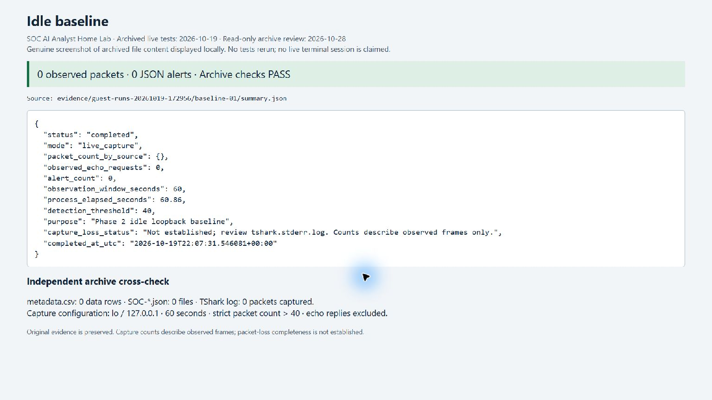
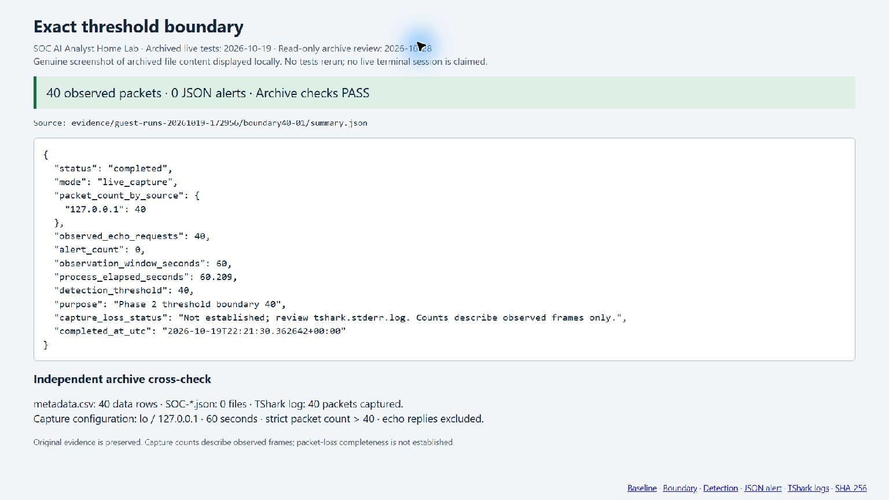
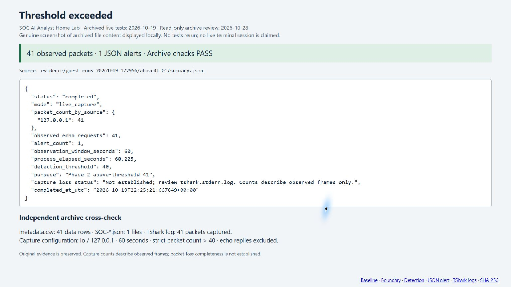
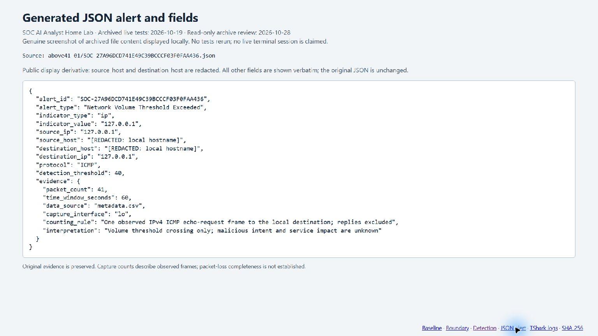
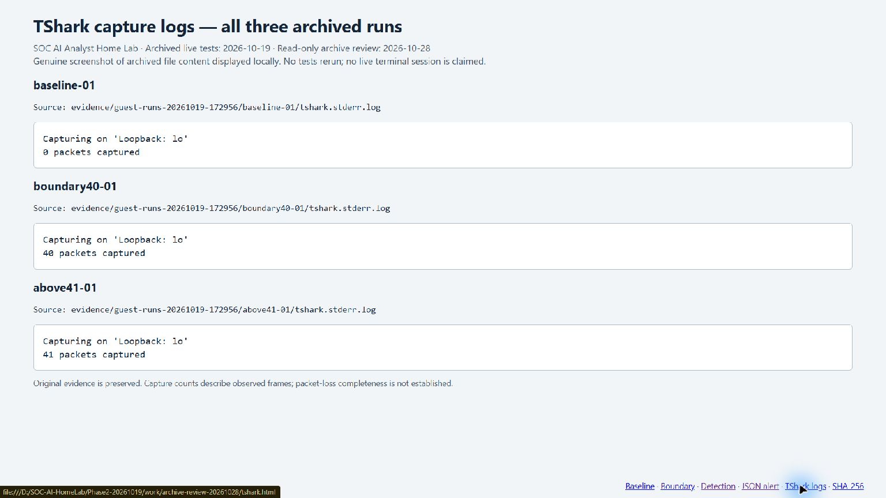
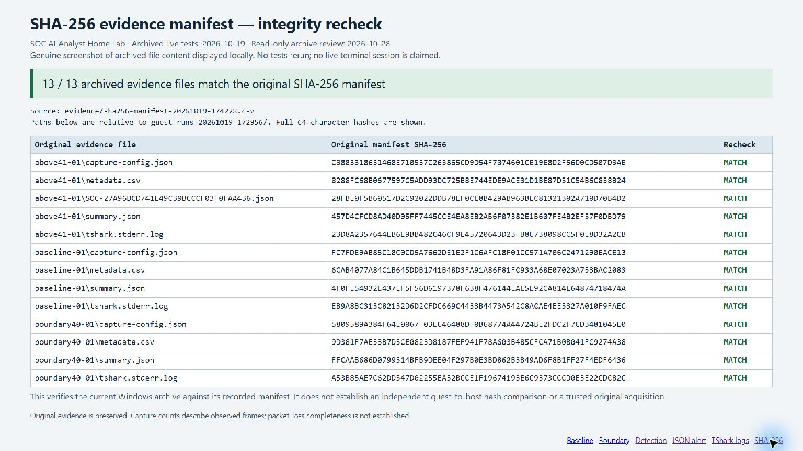

# Phase 2 — Python Network Sensor and Live Validation

**Project:** SOC AI Analyst Home Lab  
**Live tests:** October 19, 2026  
**Archive and documentation review:** October 28, 2026  
**Status:** COMPLETE — local sensor validation, screenshot archiving, and documentation verified.

Phase 2 captured real IPv4 ICMP echo-request metadata, counted requests per source over a fixed 60-second observation, and generated local JSON alerts only when a source exceeded 40 observed requests. Archived results are **0 packets / 0 alerts**, **40 packets / 0 alerts**, and **41 packets / 1 alert**.

This closeout reads existing files. No capture, traffic generation, offline test, VM change, Langflow change, or NVIDIA API request was performed on October 28.

## Architecture and phase boundary

~~~mermaid
flowchart LR
    P["Benign loopback ICMP requests"] --> T["TShark / dumpcap lo · 127.0.0.1 · 60 s"]
    T --> C["metadata.csv IPv4 echo requests only"]
    C --> S["Python sensor per-source count > 40"]
    S --> J["Local JSON alert"]
    T --> L["TShark stderr log"]
    S --> R["Capture config and summary"]
    J --> A["Windows evidence archive SHA-256 manifest"]
    L --> A
    R --> A
    C --> A
~~~

All validated traffic stayed on the sensor guest's loopback interface. Earlier notes record VMware hosting on Windows D:, NAT networking, and an external guest adapter; those network paths were not exercised by these tests.

The existing Phase 1 Langflow/NVIDIA analyst remains separate. The actual Phase 2 alert has not been submitted to it. Separate-VM traffic is unvalidated. Phase 3 is not started.

## Source and configuration

Implementation: [soc_capture.py](../src/soc_capture.py). Offline cases: [test_soc_capture.py](../tests/test_soc_capture.py).

| Setting | Archived value or implementation behavior |
|---|---|
| Capture interface | `lo` |
| Authorized source and local destination | `127.0.0.1` |
| Protocol / ICMP type | IPv4 protocol `1`; echo request type `8` |
| Observation | One fixed 60-second capture; not a rolling window |
| Alert condition | Per-source observed count **> 40** |
| Capture options | `-n` no name resolution; `-p` non-promiscuous; `-s 64` snaplen |
| Retained packet data | Six CSV metadata fields; no PCAP or payload field output |
| Metadata fields | `frame.number`, `frame.time_epoch`, `ip.src`, `ip.dst`, `ip.proto`, `icmp.type` |
| Output protection | New directories/files only; existing run output is refused |
| Runtime safeguards | Linux only; ordinary user; destination must belong to interface; `any` rejected |
| Failure handling | `failure.json` on failure; partial captures are not completed runs |

The analyzer rejects malformed columns, duplicate/out-of-order frames, invalid timestamps, out-of-scope traffic, and metadata spanning more than the configured window. Counts refer to observed frames. Echo replies are excluded by the filter.

Earlier operator notes identify Ubuntu 24.04.5 LTS, Python 3.12.3, and TShark 4.2.2. The supplied 13-file run archive has no independent OS/package-version transcript. These versions are historical context, not freshly verified inventory.

## Commands associated with the completed tests

Each `capture-config.json` preserves the exact TShark argument array. Its shell rendering is:

~~~sh
tshark -n -p -i lo -s 64 \
  -f 'ip and icmp and icmp[icmptype] = icmp-echo and dst host 127.0.0.1 and (src host 127.0.0.1)' \
  -a duration:60 -T fields \
  -E header=y -E separator=, -E quote=d -E occurrence=f \
  -e frame.number -e frame.time_epoch -e ip.src -e ip.dst \
  -e ip.proto -e icmp.type
~~~

The sensor recipe below is reconstructed from the archived configuration and current source. It is documentation, not a retained terminal transcript or an instruction to rerun:

~~~sh
python3 -B soc_capture.py \
  --interface lo \
  --destination-ip 127.0.0.1 \
  --source-ip 127.0.0.1 \
  --output runs/baseline-01 \
  --purpose 'Phase 2 idle loopback baseline'
~~~

Other archived output directories are `boundary40-01` and `above41-01`, with purposes `Phase 2 threshold boundary 40` and `Phase 2 above-threshold 41`. Earlier notes record benign ping sequences at approximately one request per second:

~~~sh
# Historical recipe: separate capture windows.
ping -n -c 40 -i 1 -s 0 127.0.0.1
ping -n -c 41 -i 1 -s 0 127.0.0.1
~~~

No ping stdout transcript survives in the supplied run archive. The retained CSV metadata, summaries, and TShark logs independently support the observed counts.

## Verified results

| Archived run | Metadata rows | Summary requests | TShark count | Alert files | Process elapsed | Result |
|---|---:|---:|---:|---:|---:|---|
| `baseline-01` | 0 | 0 | 0 | 0 | 60.860 s | PASS |
| `boundary40-01` | 40 | 40 | 40 | 0 | 60.209 s | PASS |
| `above41-01` | 41 | 41 | 41 | 1 | 60.225 s | PASS |

The baseline CSV is header-only. Every populated row uses loopback source/destination, protocol `1`, and ICMP type `8`. Per-source summary totals agree. The boundary case confirms that exactly 40 does not alert; 41 does.

| Run | Capture start (UTC, October 19) | Summary completion (UTC, October 19) |
|---|---|---|
| Baseline | 22:06:30.686007 | 22:07:31.546081 |
| Boundary | 22:20:30.151272 | 22:21:30.362642 |
| Detection | 22:24:21.440320 | 22:25:21.667849 |

Process elapsed time includes startup/exit overhead. Packet timestamp spans are approximately 39.963 seconds for boundary and 40.996 seconds for detection, within their capture windows.

The prior `evidence/offline-tests.txt` records **13 tests, OK**. It was inspected, not rerun. Previously documented three-request smoke capture, source-transfer hash match, and setup checks have no separate retained records in this run bundle; they are not additional independently verified acceptance results.

## Generated JSON alert

The detection run contains one alert:

`above41-01/SOC-27A96DCD741E49C39BCCCF03F0FAA436.json`

| Field | Verified value / meaning |
|---|---|
| `alert_id` | `SOC-27A96DCD741E49C39BCCCF03F0FAA436` |
| `alert_type` | `Network Volume Threshold Exceeded` |
| `indicator_type` | `ip` |
| `indicator_value`, `source_ip`, `destination_ip` | `127.0.0.1` |
| `source_host`, `destination_host` | Same local guest hostname; redacted in public display |
| `protocol` | `ICMP` |
| `detection_threshold` | `40` |
| `evidence.packet_count` | `41` |
| `evidence.time_window_seconds` | `60` |
| `evidence.data_source` | `metadata.csv` |
| `evidence.capture_interface` | `lo` |
| `evidence.counting_rule` | One observed IPv4 echo-request frame; replies excluded |
| `evidence.interpretation` | Volume threshold crossing only; intent and service impact unknown |

This alert is a threshold observation, not proof of malicious intent, compromise, a flood, or service degradation. The original JSON remains unchanged. Only the public display replaces the two hostname values with explicit redaction markers.

## Problems and fixes

| Recorded problem | Resolution and evidence boundary |
|---|---|
| Non-root capture initially denied | Earlier notes record restricted dumpcap access for the capture group and `newgrp wireshark` to refresh membership. Successful captures support functional access; exact permissions/capabilities were not re-inspected. |
| VMware shared folder inaccessible | Earlier notes record mounting as the ordinary guest user and copying the sensor. No VM/mount changes were made at closeout. |
| Source transfer needed verification | Earlier notes record matching source hashes; supporting transfer transcript is unavailable. Independent guest-to-host evidence hashing remains unrecorded. |
| Repeatability / overwrite risk | Separate named runs; exclusive output creation in source. Original archive remains unchanged. |
| Integrity records needed | Original manifest covers all 13 run files. October 28 rehash matched 13/13. |
| Escaped Markdown and stale README | Restored GitHub Markdown, corrected status against archived results, and added evidence-backed explanations/screenshots. |
| Local identifiers in public material | Removed machine-specific paths, VM MACs, and guest hostname from public prose; alert hostname values are visibly redacted. Raw evidence stays private by default. |

## Evidence and integrity

Private archive: `evidence/guest-runs-20261019-172956/`.

- Baseline: configuration, metadata, summary, TShark log — 4 files.
- Boundary: configuration, metadata, summary, TShark log — 4 files.
- Detection: configuration, metadata, summary, TShark log, alert — 5 files.

Original record: `evidence/sha256-manifest-20261019-174228.csv`. Paths are relative to the run archive. All **13/13** files matched on October 28. This verifies consistency with the recorded Windows manifest, not independently authenticated acquisition or a guest-to-host comparison.

Closeout records:

- [Archive verification](../evidence/phase2-archive-verification-20261028.json): results and per-file original/actual hashes.
- [Closeout verification](../evidence/phase2-closeout-verification-20261028.json): screenshot, link, privacy, and preservation checks.
- [Closeout hashes](../evidence/phase2-closeout-sha256-20261028.csv): new screenshots, records, and final documentation. Supplements the original manifest.

Original evidence, including the pre-existing contact sheet, is preserved. The old Markdown and README were backed up under private `work/archive-review-20261028/` alongside the original evidence hash inventory and local viewer sources.

## Screenshots

These are genuine Chrome window captures taken October 28 while reviewing the October 19 archive. They show local read-only evidence views with source filenames; they are **not contemporaneous screenshots of the original test terminals**. The views display archived JSON/log text with cross-check labels derived from file counts and hashes. Original JPEG window captures were losslessly re-encoded as PNG without content edits. Decoded pixel hashes of all six saved PNGs match their source captures.

The alert view explicitly redacts two local hostname values. Full-screen window capture excludes browser profile controls and unrelated windows.

All six PNGs are saved directly under `evidence/`:

| Filename | Content |
|---|---|
| `phase2-20261028-baseline-0-packets-0-alerts.png` | Baseline summary and archive cross-check |
| `phase2-20261028-boundary-40-packets-0-alerts.png` | Boundary summary and archive cross-check |
| `phase2-20261028-detection-41-packets-1-alert.png` | Detection summary and archive cross-check |
| `phase2-20261028-generated-json-alert-redacted.png` | All alert fields; hostname redaction marked |
| `phase2-20261028-tshark-capture-logs.png` | Three original TShark logs |
| `phase2-20261028-sha256-evidence-manifest.png` | All 13 full hashes and recheck results |

### Baseline: 0 packets, 0 alerts

### Boundary: 40 packets, 0 alerts

### Detection: 41 packets, 1 alert

### Generated JSON alert

### TShark capture logs

### SHA-256 manifest

## Publication and limitations

README, this report, source, tests, six reviewed PNGs, and closeout records are prepared for GitHub. Ignore rules selectively permit these reviewed artifacts while excluding raw run evidence, credentials, PCAPs, work files, and reference assets. No repository publication, commit, push, or upload was performed.

- Validation covers loopback IPv4 echo requests only, not arbitrary protocols or separate-VM traffic.
- Capture-loss completeness is not established. Logs provide captured counts without independent loss telemetry.
- No raw packet files were retained, limiting packet-level reconstruction.
- The fixed-window count rule does not establish a production baseline or attack classification.
- No independent guest-to-host evidence hash comparison is recorded.
- Historical setup, versions, and source-transfer details lack retained transcripts in this bundle.
- The actual generated alert has not passed through Langflow/NVIDIA.
- Tutorial provenance and redistribution rights are unverified; reference assets stay excluded.
- Current archive screenshots cannot replace unavailable contemporaneous test screenshots.

**Phase 2 is fully complete within its local sensor scope.** All six screenshots exist and were visually checked; saved image pixels match the genuine window captures; documentation links resolve; all 17 pre-existing evidence files remain byte-for-byte unchanged, including all 13 manifested run files. The known limitations above remain documented. Phase 3 has not started and requires separate instruction.